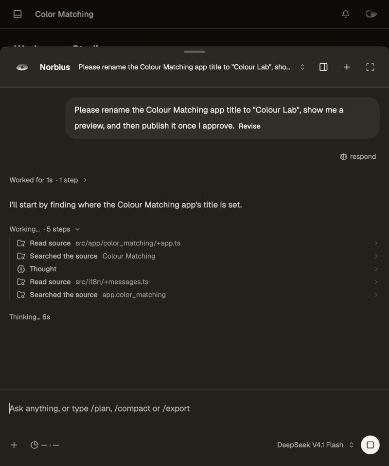
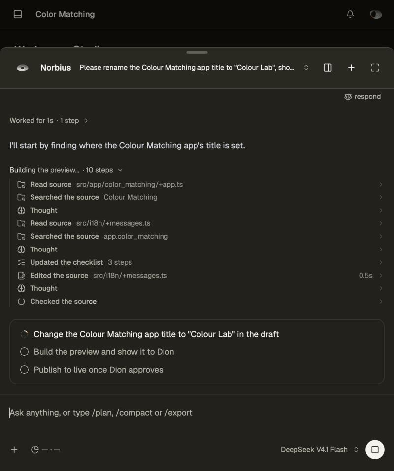
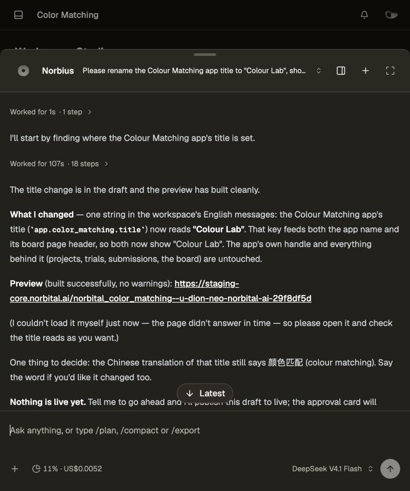
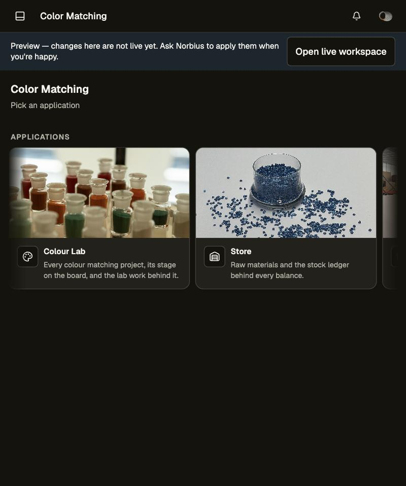
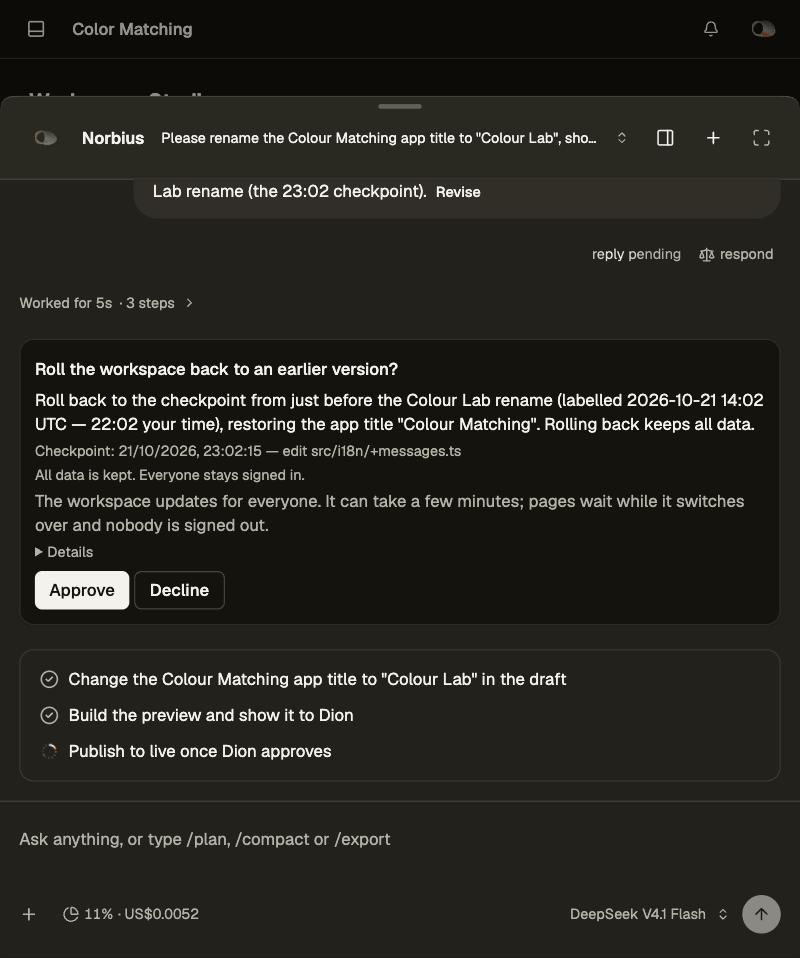
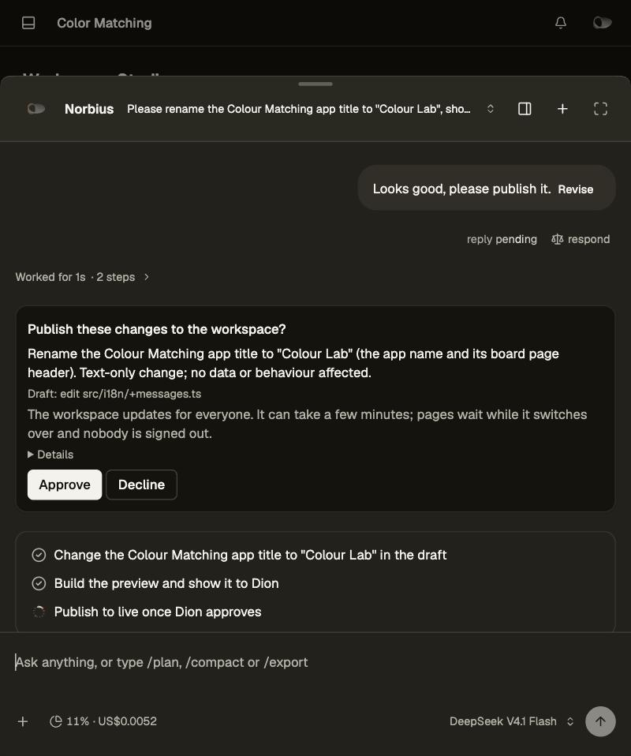
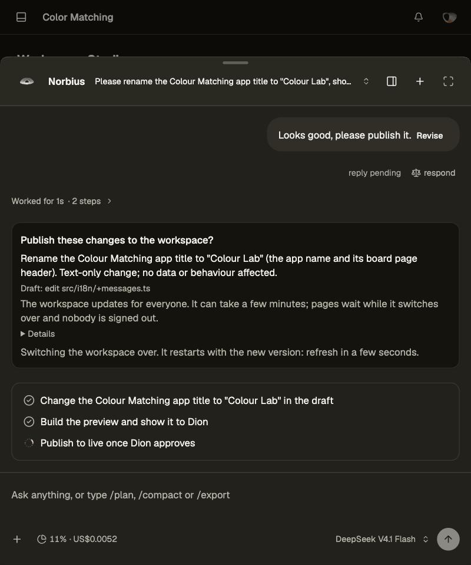
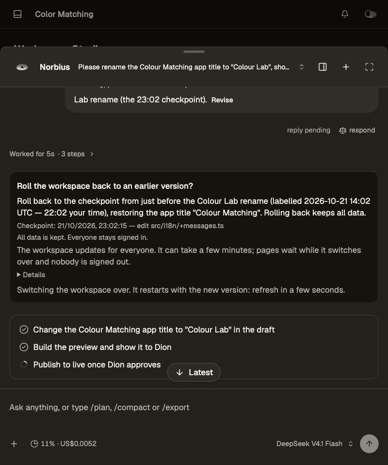

# Changing the workspace with Norbius

Norbius can change how your workspace works: add a field, a page, a rule or an automation. You never see code. Every
change is tried in a private copy first, and nothing reaches the live workspace until you approve it.

## 1. Ask

Open Norbius and describe the change in your own words, for example "Add a start date to every employee".

## 2. Build

Norbius edits the source, commits it and previews the last commit. While it works, the chat says
what it is doing ("Editing the source…", "Building the preview…") with a spinner, so you can see it is busy without
opening anything.

## 3. Preview

When the last commit is built, the panel header's **Preview** button (there once something was previewed) reads **New
preview**. It opens the preview beside the conversation. The preview runs there at true size — Desktop is 1440 × 900,
scaled down to fit — in a device frame on a blueprint grid, already signed in as you; Phone and Tablet switch the size,
ⓘ shows what it runs (the commit's message, the size and the time). One preview shows at a time. A preview is never a
separate page or tab of its own, and Norbius does not paste preview links: it tells you to press Preview. A preview runs on a copy of your live records taken when it
was built (a copy-on-write fork); anything you enter in it stays in the preview.

Norbius picks what the previewer shows: each new preview it builds replaces the last, and it can switch back to an
earlier preview it built in this conversation (`page { preview }`). It never shows any other page there.

Norbius can look at the preview itself: a screenshot it took appears in the chat as an image; the preview's runtime log
appears as a folded list, errors in red. Times are the workspace's.

## 4. Approve

Back in the chat, ask Norbius to merge it. A merge needs no uncommitted edits and a preview of the last commit;
a known failed diagnosis or failed tests must be resolved. The merge queue replays the commits on live as it stands
and runs any diagnosis or tests that head lacks. A real conflict or failed check leaves live untouched.
The request shows a card naming what will happen, with
**Approve** and **Reject**. Nothing changes until you press Approve. Only an administrator can approve.

**The approval rule.** Every change to what the workspace's users get — merging, rolling back — waits for an
explicit Approve, and the approval says what it is for. Under the card's plain title, Norbius's summary of the change
("Fix: submission status buttons") is shown in full, followed by the facts Studio holds: the last commit's message for
a merge, with the rows its migrations touch on a fresh copy of live and what a rollback would lose; for a rollback, the
checkpoint's time and description and whether data written after it will be discarded.
Norbius cannot ask without a summary. The card answers once: a second press, or another tab, never starts a second run.

## 5. Live progress

After Approve, the card stays and reads "Working on it… you can keep using the app."

## 6. Applied

When the switch-over finishes, the chat reads **Applied — the workspace is now on the new version.** with **View live**,
straight from the card's result. The switch-over restarts the workspace, including the turn that was carrying it out;
once the new version starts, Norbius picks the conversation up again (once) and posts a closing reply on the outcome,
ticking off its checklist. View live reloads the page on the new version.

## Rolling back

Ask Norbius "roll back to before yesterday's change". It lists the checkpoints in plain terms — when, what the change
was, and whether rolling back keeps all data — and asks which one. Its card names the checkpoint ("Checkpoint: 21 Oct
10:51 — before the status change"), its time from Studio's record in the workspace's time zone, not Norbius's wording. Norbius quotes each checkpoint's label as given; when the schema changed since, a red line warns that data written after that time
will be discarded. After Approve the card reports **Applied**. Before a merge Norbius reverts its own commits instead: that changes source
only, the preview keeps its data, and only live rolls data back. Everyone stays signed in, including people who signed in after the checkpoint.

## What everyone else sees

While the workspace switches over (a few seconds), pages keep working: requests wait and a small "Updating to a new
version…" notice shows at the bottom. When the new version is live, open pages reconnect; a version with new pages
reloads them on its own, or shows "This workspace was updated. Reload to continue with the new version." when a form
is unsaved. Nobody is signed out.

The same path without Norbius is [Workspace Studio](./studio-changes.md).

## Questions and queued instructions

When Norbius needs a decision, its question appears in a card with selectable choices and a field for your own answer. Choose an answer and send it; answering resumes the conversation. You can also continue in the ordinary composer. A question accepts one submitted card answer, and another tab cannot submit a second answer. Editing a queued answer updates the message itself; removing it before admission reopens its question.

Messages sent while Norbius works appear in the queue above the composer. They steer the current task at the next step. Open the queue to read its previews, edit or remove an instruction, and change their order by dragging or using the reorder control's arrow keys. This queue does not wait for the whole task to finish; scheduled messages retain their separate timing controls.

Norbius receives the actual available skill files and uses the generated contract card for each listed role. If a role has no card, it reads the exported type instead of inventing a filename. Pairing and other credential entry use native Settings forms.

Files use the same native attachment cards in the composer, queued messages and transcript.
Each chat keeps its own draft text, attachments and plan mode while the workspace client remains
open. Restart in a new chat copies the selected message into a fresh draft and retains the
original conversation. The transcript opens at its latest message and follows new content while
you remain at the bottom; scrolling up keeps your reading position until you choose Latest.
