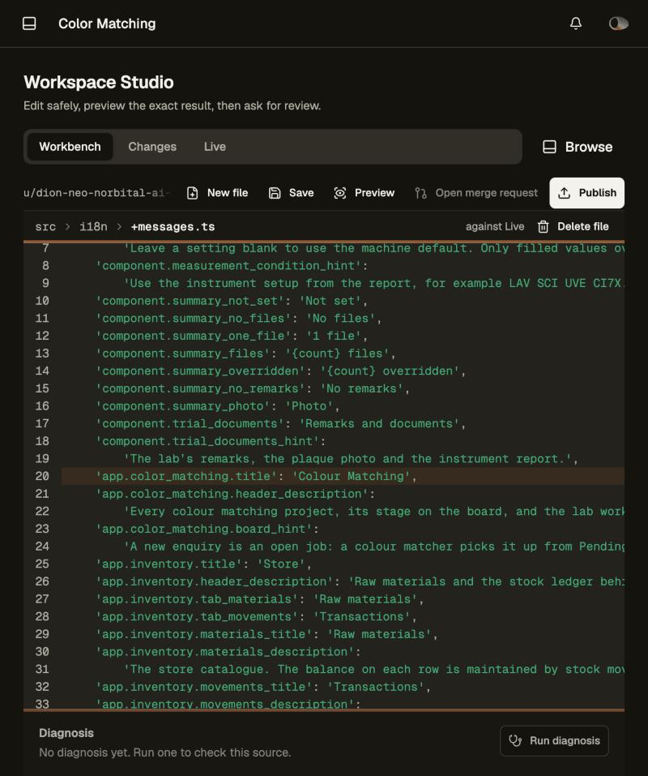
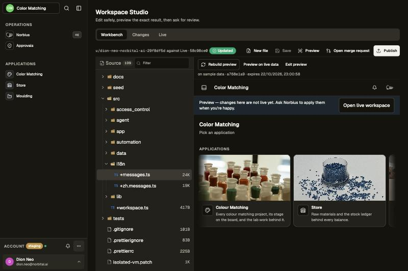
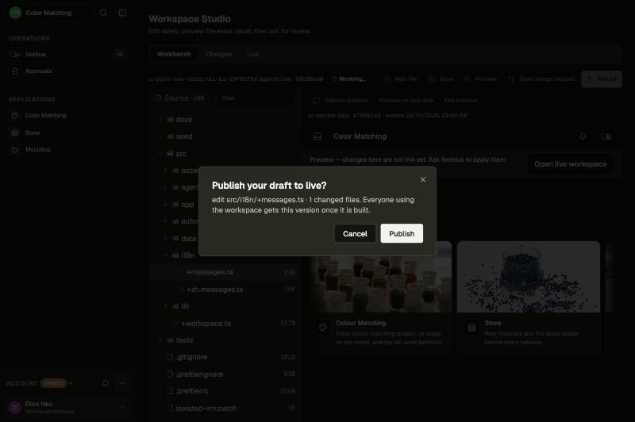
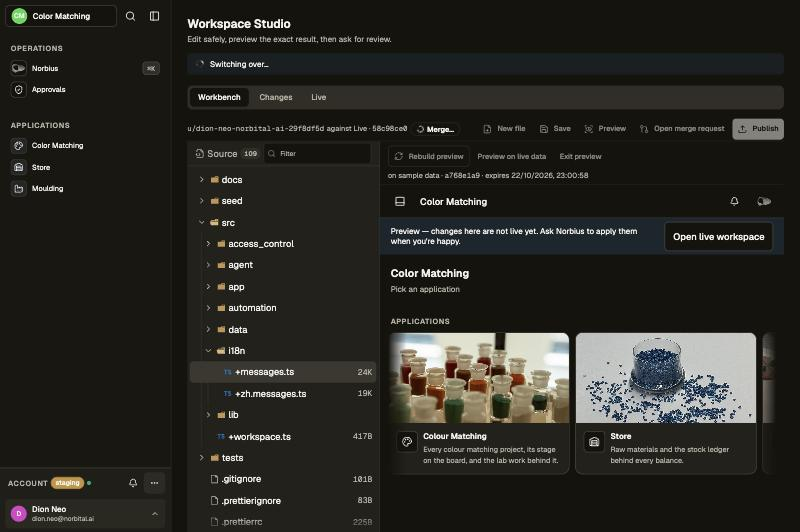
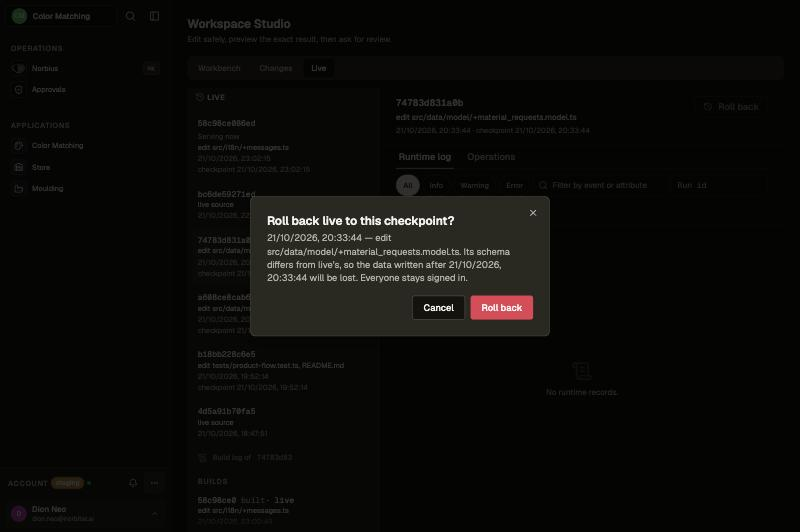

# Changing the workspace in Studio

Workspace Studio is the same path as [asking Norbius](./norbius-changes.md), by hand: edit the source, commit it, rebase it
when live moved, run the diagnosis and the tests, merge it, and roll live back if needed. Every step that changes what the workspace's users get asks for an
explicit approval that says what it changes. Studio needs a host that serves it (Colony); an untethered workspace has
none. Its UI is the host's too, and is no part of a workspace's build: the shell holds an empty slot, and the host's bundle
mounts there and talks to the workspace over the `/__bolt/shell/studio*` routes. What happens across the workspace — bundle analysis, resource telemetry, runtime logs, the audit
trail, automation runs, inference calls and people — is the **Command center** (`/command-center/<tab>`), in tethered
and untethered workspaces alike; commits, previews, merges and rollbacks stay in Studio.

## 1. Edit and commit

Open **Workspace Studio** from the account menu's System group. The Source tab shows the source tree and an editor over your own working tree; nobody else
sees it. Edit, then **Commit**. A commit is a checkpoint with a message: it takes any state, errors included. It asks
"What does this commit do?" with a suggestion as the placeholder ("Update i18n messages"). History is linear. Norbius
writes its own commit messages the same way.

## 2. Your commits

A person has one line of commits at a time, on top of live. Nothing creates or closes it: the first edit starts it and
new commits join it. A merge takes that line in and carries a message: its first commit's, edited in place behind a
hover pencil.

The navigator is a side panel that pushes the page, and on a phone it pushes down from the toolbar. It has three tabs:

- **Source**: the file tree. A file opens raw, with what happened to it against live beside its path.
- **Your work**: your commits, "N commits to merge", and the files they changed. Pick a file to set it side by side, against
  the start of your work, live or any of your commits. Diagnosis and Tests are independent checks, in any order.
- **Live**: the versions live ran, shared by everyone. Pick one to see what it changed. Only here does anything roll back.

The toolbar holds one button, whatever is left to do: commit, rebase when behind, **Ask Norbius to fix this** on a conflict,
run a check, and finally **Merge**, which builds first if it has to, proves any migration and asks for its message.

**Revert** on one of your commits drops it and every commit after it. It changes source only: the preview's database
branch keeps its data. Reverted commits cannot be brought back. Only **Roll back** on Live restores data.

## 3. Rebase

History is linear. Other people's merges move live, and each author rebases: while you are behind live the next step is
**Rebase**, which replays your commits on top of live. The head changes, so the diagnosis and the tests run again.

`migrations/` almost never conflicts, because a rebase resolves it instead of merging it:

- A merged migration has run on live, so it stays byte for byte, with `snapshot.json`, `migrations.lock.json` and
  `physical.json` up to that point.
- Your own migrations are written again from live's schema as it stands now, renumbered on top, each in the commit that
  brought it. What you wrote by hand, such as a backfill or a conversion, is carried across and never regenerated away.
- The build then replays every file against what the merged source declares, and its proofs join your last commit. That
  build is your head's, so the preview that follows has nothing left to build.

Where a step's meaning changed because of what merged first, the rebase stops for you: a column someone else already added
or retyped, a data step that uses a column live changed, a hand edit of a line the regeneration changed, or a migration that
no longer replays. So does any source file both of you changed. These land in the commits as marked files, and live is
untouched. Studio says what happened in plain words and offers one button, **Ask Norbius to fix this**, which sends the
request to Norbius. Fixing it by hand works too: edit the files and commit. The commit that clears the last marked file
finishes the rebase: the build proves the migrations and its proofs join that commit.

## 4. Diagnosis and tests

**Diagnosis** runs the type check and the compiler checks on your working tree; **Tests** runs the workspace's tests.
Both run by hand, never automatically: no commit, preview or merge starts one. Each result is kept by the exact source
it ran on, so committing a tree that passed keeps its result. The **Diagnosis** and **Tests** tabs show what each last
found.

## 5. Preview

The **Preview** tab builds the last commit when opened, and **Merge** builds it if nobody has, because a build is what
names a merge's destructive steps. It is — uncommitted edits are never previewed, so commit first. The build shows in that tab, already signed in as
you — no second sign-in. It runs on a copy-on-write fork of live's data taken at that moment: your real records,
and nothing you do there reaches live. While it builds, the tab names the current step ("Building…", then
"Starting the preview…") and the time so far. It never serves the previous head while a newer one builds: until
that commit's bundle exists the tab is a placeholder that names the wait. A preview is never a page of its own: it
only shows inside this frame (or the Preview panel beside Norbius's conversation). The frame's
header reads "Preview · <merge message>"; **Phone** (390 × 844), **Tablet** (820 × 1180) and **Desktop** (fills
the pane) size it, its right and bottom edges drag to any size (shown as width × height), and **Reload** reloads
it. The page inside lays out exactly as in a browser of that size, and the last size is remembered on this device.
Opened directly, a preview goes to Studio. Inside a preview, Studio offers no Preview, Merge or Rollback: "You're
inside a preview — open Studio from the live workspace."

## 6. Merge

Merging needs no uncommitted edits, commits on top of live, a passed diagnosis and passed tests on the last commit, and
a preview of that commit. A merge reads those results and runs neither, and it never replays: while behind live it
refuses until you rebase.

A migration runs on live at merge, and only a rollback undoes it, while a preview's fork can be older than live. So
**Merge** (an administrator's) first runs your migrations on a fresh, throwaway copy of live's data as it is then. One that
fails there stops here, with the reason, and live is untouched. Then it asks "Merge into live?", with the merge's message,
a summary of what its commits do together, the rows the migrations touch on that copy, the expected downtime, and what a
rollback would lose: anything written after the merge, because the schema differs. The merge rehearses once more just before
the switch-over, on live as it is by then, so a scheduled merge or a slow approval is proved on the data it will meet.
Norbius's `workspace_merge` rehearses the same way, and the approval carries the same lines.
The dialog also asks **now** or **at a time**: a later instant schedules the same merge for then.
Nothing changes until you confirm. While it runs every Studio button is disabled, so a double click cannot start a
second run, and the header reports "Getting ready…" → "Building…" → "Switching over…" with the time so
far — it only moves forward within a run — then "Done — live runs the new version." or "Failed: <reason>".
A failed merge shows `Merge failed: <reason>`; the workbench returns to its idle state so the commits can be fixed and
merged again.

## 7. Roll back live

Revert and roll back are different verbs: revert drops your commits to merge, in source; a rollback returns live to a
Version, source and data together, and only live rolls data back. In the timeline's **On live** group select an entry and
press **Roll back live**. It is offered only where a checkpoint is still restorable: a reset replaces live's database, so
nothing from before it can be rolled back to. Norbius lists the same checkpoints (`workspace_review`, with
times in the workspace's own timezone) and refuses the same ones. The confirmation shows the checkpoint's
time and description, and says either that all data is kept or, when the schema changed since, that data written after
that time will be lost. Live as it was is kept, so a rollback can be undone. The same progress follows in the header.
Everyone stays signed in, including people who signed in
after the checkpoint. Current permissions, deactivations, sign-outs and agent-session identity also survive:
a rollback restores business data while retaining current identity state.

## What everyone else sees

During the few seconds of a switch-over, other people's pages wait instead of failing; a small "Updating to a new
version…" notice shows at the bottom. Afterwards their pages reconnect; a version with new pages reloads them, or
offers **Reload** when they have unsaved work.

## Screenshots to capture

| File                | Must show                                                                                          |
| ------------------- | -------------------------------------------------------------------------------------------------- |
| `studio-flow-1.jpg` | The Source tab with a file open and an uncommitted edit (the Commit button enabled).               |
| `studio-flow-2.jpg` | The Preview tab: the frame header, the Phone/Tablet/Desktop sizes and the page.                    |
| `studio-flow-3.jpg` | The merge dialog: "Merge into live?", the merge's message and changed-file count, and the summary. |
| `studio-flow-4.jpg` | The header reading "Switching over…" with a spinner, and the Studio buttons disabled.              |
| `studio-flow-5.jpg` | The rollback confirmation for a checkpoint whose schema differs: time, description, data warning.  |
| `studio-flow-6.jpg` | Another member's page during the switch-over: content still on screen and the "Updating" notice.   |
