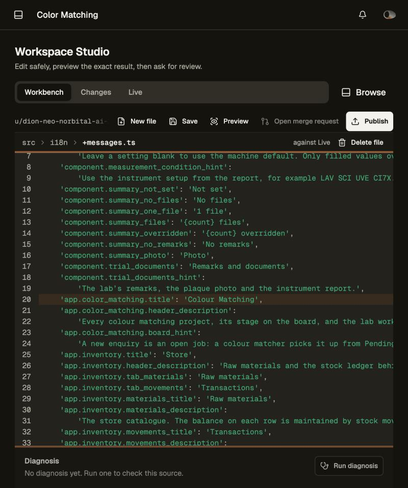
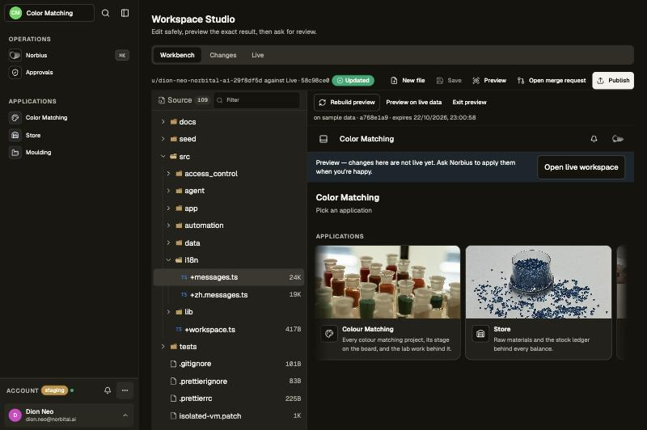
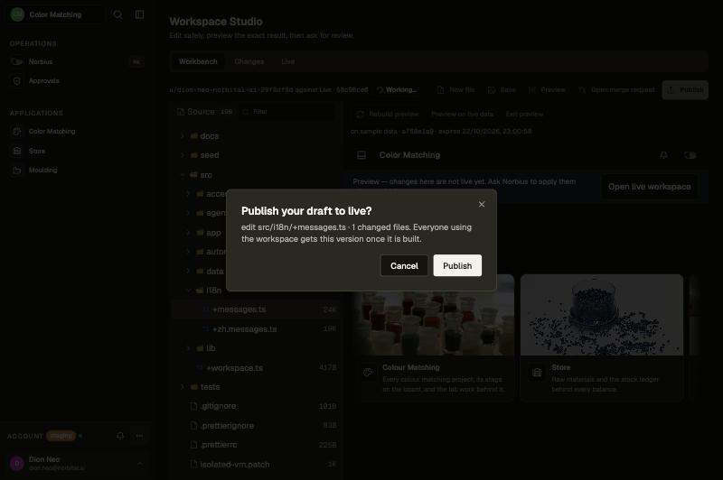
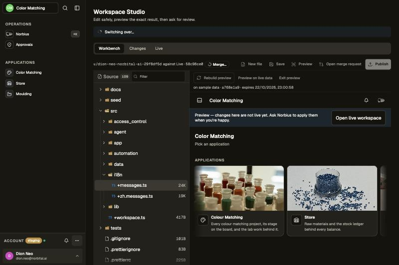
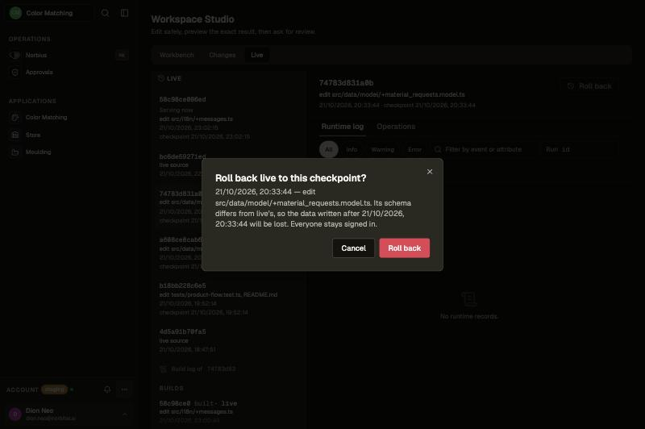

# Changing the workspace in Studio

Workspace Studio is the same path as [asking Norbius](./norbius-changes.md), by hand: edit the source, preview it,
publish or merge it, and roll back if needed. Every step that changes what the workspace's users get asks for an
explicit approval that says what it changes.

## 1. Edit

Open **Studio** from the sidebar. The Workbench shows the source tree and an editor over your own draft; nobody else
sees it. Edit, then **Save**. Save asks "What does this change do?" with a suggestion filled in ("Update i18n
messages"); the description is required and becomes the saved version's description, which the publish confirmation
shows. Norbius describes its own saves the same way.

## 2. Preview

Press **Preview**. The draft is built and shows inside Studio's preview pane, already signed in as you — no second
sign-in. It runs on a copy-on-write fork of live's data taken at that moment: your real records, and nothing you do
there reaches live. While it builds, the pane names the current step ("Building…", then "Starting the preview…") and the time so
far. A preview is never a page of its own: it only shows inside this frame (or the Preview card in Norbius's Session sidebar). The frame's
header reads "Preview · My draft · <commit>"; **Phone** (390 × 844), **Tablet** (820 × 1180) and **Desktop** (fills the
pane) size it, its right and bottom edges drag to any size (shown as width × height), and **Reload** reloads it. The
page inside lays out exactly as in a browser of that size, and the last size is remembered on this device. Opened
directly, a preview only says "This is a preview — open it from Studio or Norbius." Inside a preview, Studio offers no
Preview, Publish or Rollback: "You're inside a preview — open Studio from the live workspace."

## 3. Publish or merge

**Publish** (an administrator's own draft) or **Merge** (an approved merge request on the Changes tab) first asks:
"Publish your draft to live?" or "Merge !12 into live?", with the commit message or merge request title below it.
Nothing changes until you confirm. While it runs every Studio button is disabled, so a double click cannot start a
second run, and a strip under the title reports "Getting ready…" → "Building…" → "Switching over…" with the time so
far — it only moves forward within a run — then "Done — live runs the new version." or "Failed: <reason>".

## 4. Roll back

On the **Live** tab pick a deployment (a checkpoint) and press **Roll back**. Only a deployment whose checkpoint is
still restorable can be picked: a reset replaces live's database, so deployments from before it stay listed, marked
"Before the last reset — can't roll back to this", and never reach the confirmation; a version without a checkpoint
says "This version has no checkpoint to roll back to". Norbius lists the same checkpoints (`workspace_builds`, with
times in the workspace's own timezone) and refuses the same ones. The confirmation shows the checkpoint's
time and description, and says either that all data is kept or, when the schema changed since, that data written after
that time will be lost. The same progress strip follows. Everyone stays signed in, including people who signed in
after the checkpoint. Current permissions, deactivations, sign-outs and agent-session identity also survive:
a rollback restores business data while retaining current identity state.

## What everyone else sees

During the few seconds of a switch-over, other people's pages wait instead of failing; a small "Updating to a new
version…" notice shows at the bottom. Afterwards their pages reload into the new version, or offer **Reload** when they
have unsaved work.

## Screenshots to capture

| File                | Must show                                                                                         |
| ------------------- | ------------------------------------------------------------------------------------------------- |
| `studio-flow-1.jpg` | The Workbench with a file open and an unsaved edit (the Save button enabled).                     |
| `studio-flow-2.jpg` | The preview pane after Preview: the frame header, the Phone/Tablet/Desktop sizes and the page.    |
| `studio-flow-3.jpg` | The publish confirmation dialog: its title, the draft's commit message and changed-file count.    |
| `studio-flow-4.jpg` | The progress strip reading "Switching over…" with a spinner, and the Studio buttons disabled.     |
| `studio-flow-5.jpg` | The rollback confirmation for a checkpoint whose schema differs: time, description, data warning. |
| `studio-flow-6.jpg` | Another member's page during the switch-over: content still on screen and the "Updating" notice.  |
